<div align="center">

# AcadStart

**One platform for the whole school day: for management, teachers, parents and students.**

*Know where your child is at every handover · talk to the school by voice in your own language · switch from paper in a day.*


</div>

> **Status:** 🧪 Prototype / design phase. This README is the product and technical blueprint for the prototype. Code lands module by module, following the [game plan](#9-game-plan).
> **Working name:** "AcadStart" is a placeholder.

---

## Table of contents
1. [Why this exists](#1-why-this-exists)
2. [What makes AcadStart different](#2-what-makes-acadstart-different)
3. [Who it's for](#3-who-its-for)
4. [Feature map](#4-feature-map)
5. [Prototype feature set](#5-prototype-feature-set)
6. [System architecture](#6-system-architecture)
7. [How each feature works and performs](#7-how-each-feature-works-and-performs)
8. [Privacy, security & compliance by design](#8-privacy-security--compliance-by-design)
9. [Game plan](#9-game-plan)
10. [Scale-up features (open-ended)](#10-scale-up-features-open-ended)
11. [Tech stack](#11-tech-stack)
12. [Planned repository layout](#12-planned-repository-layout)
13. [Non-functional targets](#13-non-functional-targets)
14. [Glossary](#14-glossary)
15. [Contributing & license](#15-contributing--license)

---

## 1. Why this exists
Most private schools in India still run on paper registers, the paper school diary, Excel sheets and dozens of one-way WhatsApp groups. Parents chase fee receipts and wonder where the bus is. At dismissal, children are often handed over on verbal trust. Teachers re-enter the same data into several school and government systems. Management has no single view of the school.

AcadStart aims to be **the one app a school actually needs**:
- **Wedge first:** fees, attendance, homework, the school diary and parent communication, the things a school uses every single day.
- **Signature features nobody else combines:** a door-to-door **Custody Chain**, a **voice-first Tamil assistant** with two-way translated messaging, and **Snap-to-Digitise** onboarding.
- **Compliance built in:** approved-fee-only billing, public fee disclosure, EMIS/UDISE+-friendly exports, and child-data protection under India's DPDP Act.

## 2. What makes AcadStart different

| | Typical school app in India | **AcadStart** |
|---|---|---|
| **Child safety** | Bus GPS dot on a map (if any) | 🛡️ **Custody Chain**: every handover verified and logged, *home → bus → gate → class → gate/bus → home*, with alerts only when something's wrong |
| **Dismissal** | Verbal trust at the gate | 🔑 **Safe Handover**: pre-approved adults with photo + rotating QR, one-time pickup passes, instant parent confirmation |
| **Parent communication** | English text broadcasts in WhatsApp groups | 🗣️ **Voice-first, two-way translated**: parents ask and reply by Tamil voice note, teachers read and write in English |
| **Getting started** | Weeks of manual data entry | 📸 **Snap-to-Digitise**: photograph paper registers and marks sheets, confirm, done |
| **School diary & slips** | Paper diary, signed slips lost in bags | ✍️ **Digital diary and permission slips** with one-tap sign-off and a live "who hasn't signed" board |
| **Records** | Locked in the vendor's system | 📜 **Parent-held, signed, QR-verifiable records**, shared only with consent, with full data export |

Inspiration from abroad, adapted for India: dismissal management (PikMyKid, US), government parent consent apps (Parents Gateway, Singapore), translated family messaging (TalkingPoints, US), and verifiable credentials (Europass, EU). The **Custody Chain** combination (transport + gate + attendance in a single handover timeline) is AcadStart's own.

## 3. Who it's for
| Role | What they get |
|---|---|
| 🏫 **Management / Admin** | Live dashboard: attendance, fee collection, buses on the road, custody exceptions, unsigned slips, parent tickets. Configures classes, fee structures, routes, staff and gates. |
| 👩‍🏫 **Teacher** | Class and timetable overview, one-tap offline attendance, Snap-to-Digitise for paper registers, homework, diary notes, translated two-way messages with parents. |
| 👨‍👩‍👧 **Parent / Guardian** | The child's day as one timeline (custody, attendance, homework, diary), fee dues and online payment, live bus and ETA, permission slips, authorised pickups, records wallet. Tamil or English, text or voice. |
| 🎒 **Student** | Timetable, assignments and due dates, announcements, certificates. |
| 🚌 **Driver / Bus attendant** | Trip start/stop, boarding and drop confirmation per child (feeds the Custody Chain), route view, GPS fallback when the bus has no device. |
| 🛂 **Gate staff** | Gate mode: scan arrivals, verify pickups against approved adults with photo, log every handover. |

All roles live in **one mobile app with role-based views**, plus a **web admin panel** for school offices.

## 4. Feature map
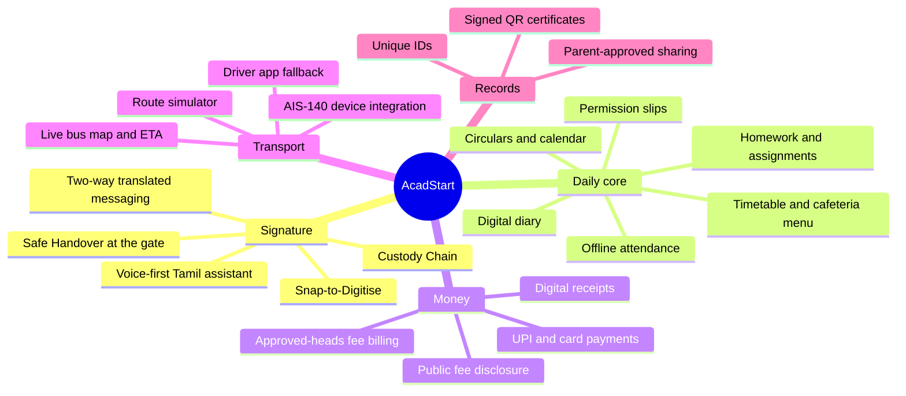

## 5. Prototype feature set
The prototype is deliberately focused: enough to run a real school day end to end, plus the three signature features.

| # | Module | Prototype scope | Roles |
|---|---|---|---|
| M0 | **Clickable demo** | No-backend interactive walkthrough of every role, leading with the Custody Chain and voice assistant | — |
| M1 | **Foundation + Snap-to-Digitise** ⭐ | Multi-school tenancy, phone-OTP login, roles, setup wizard, unique IDs, Excel/CSV import, and **photo-to-data import of paper registers and marks sheets** | Admin, Teacher |
| M2 | **Daily core + Digital diary** | Offline-first attendance and absence alerts, homework, circulars, events calendar, timetable, cafeteria menu, **digital diary notes and permission slips with one-tap sign-off** | Teacher, Parent, Student, Admin |
| M3 | **Fees** | Fee structures locked to **approved fee heads**, invoices, instalments and concessions, UPI/card payments (gateway test mode), receipts, reminders, **public fee-disclosure page** | Admin, Parent |
| M4 | **Transport + Safe Handover + Custody Chain** ⭐ | Routes and stops, live bus map and ETA, AIS-140 device ingest + driver-app fallback + route simulator, boarding/drop confirmation, **gate mode with authorised-pickup verification**, and the **child's custody timeline with exception alerts** | Parent, Driver, Gate staff, Admin |
| M5 | **Voice-first assistant + translated messaging** ⭐ | WhatsApp + push; AI assistant answering in **Tamil or English, by text or voice note**; **two-way translated teacher ↔ parent messaging** with the original always available | Parent, Teacher, Admin |
| M6 | **Identity & records** | Unique IDs with optional national/state ID links, **digitally signed QR-verifiable certificates** (events, achievements, supporting transfer records), parent-approved sharing | Parent, Admin, Teacher |

⭐ = signature feature

**Out of scope for the prototype** (see [Scale-up](#10-scale-up-features-open-ended)): exams and report cards, fee AutoPay, supplies marketplace, admissions CRM, HR/payroll, library/inventory/hostel, and government integrations beyond file export.

## 6. System architecture

### 6.1 High-level view
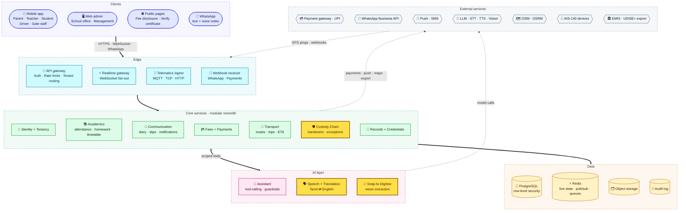
<sub>🟨 Yellow nodes = signature features. Solid arrows = request/data flow, dotted = realtime push or export.</sub>

**Design choices**
- **Modular monolith first:** one deployable backend with strict module boundaries. It's cheap to run and easy to change, and modules can later be split into services (transport, custody and messaging are the first candidates).
- **Tenant isolation in the database:** every row carries `institution_id`, enforced by PostgreSQL **row-level security**.
- **Realtime off the hot path:** bus positions and custody events flow through Redis pub/sub to the WebSocket gateway, not through the main database.
- **AI behind narrow interfaces:** the assistant can only call scoped tools, and speech, translation and vision are swappable adapters (cloud APIs or self-hosted Indic models).
- **Every integration is an adapter:** payment gateway, WhatsApp provider, LLM/speech/vision vendors, maps and GPS device vendors can all be replaced.

### 6.2 Data model: academics, fees and onboarding
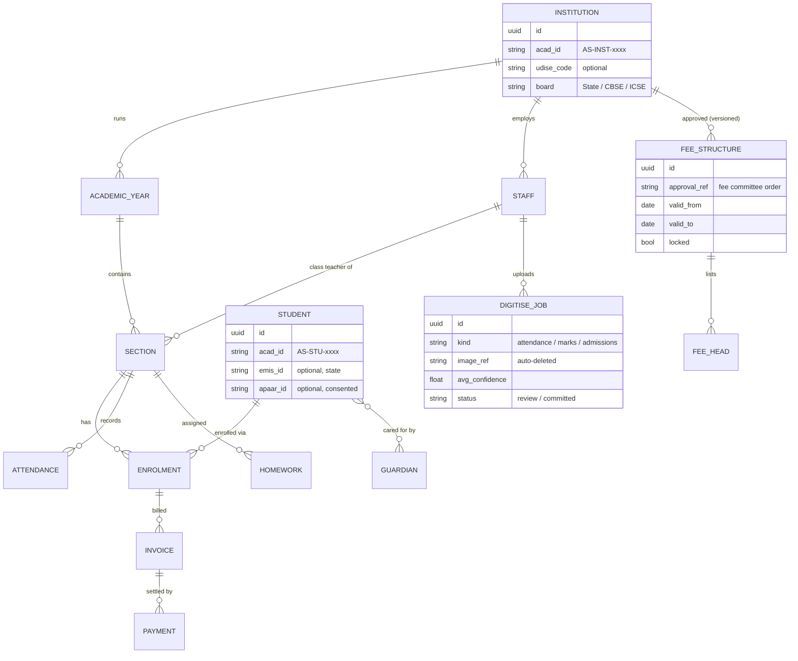

### 6.3 Data model: safety, communication and records
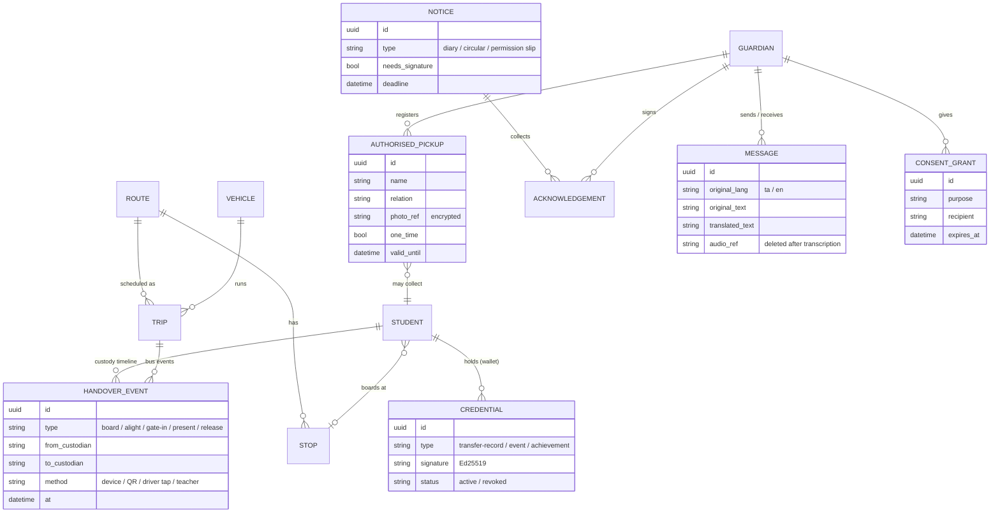

## 7. How each feature works and performs

### 7.1 Foundation + Snap-to-Digitise ⭐
**Onboarding a school in one day.** The setup wizard runs school profile → academic year → classes and sections → staff → students and guardians. Excel/CSV import auto-maps columns and previews errors before commit.

**Snap-to-Digitise** turns paper into data without retyping:
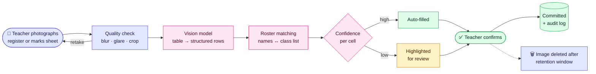
- **Roster-aware:** extracted names are matched against the class list, so handwriting errors snap to real students.
- **Human in the loop:** nothing is committed without the teacher's confirmation, and low-confidence cells are highlighted.
- **Works for:** daily attendance registers, marks registers, old admission registers (bulk back-filling).
- **Logins and IDs:** phone + OTP for everyone. Permanent internal IDs (`AS-INST-…`, `AS-TCH-…`, `AS-STU-…`). UDISE+ code, EMIS ID and APAAR ID are optional linked fields, never primary keys. Aadhaar is never required.
- **Targets:** a 1,000-student school live within **one working day**; a 40-row register page digitised and confirmed in **under 2 minutes**; **≥ 95%** of cells correct before review.

### 7.2 Attendance: offline-first
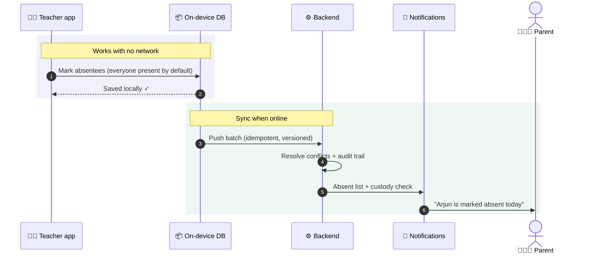
- A class of 40 is marked in **under 30 seconds**. Absence alerts arrive **within 5 minutes** of sync.
- Attendance is also a Custody Chain checkpoint (see 7.5). "Arrived at gate but not marked present" raises an exception.

### 7.3 Digital diary and permission slips
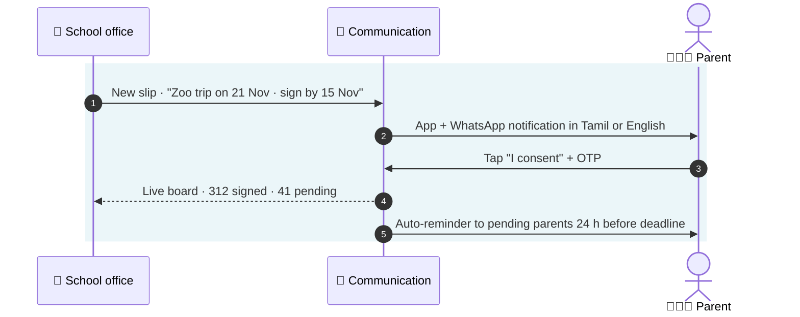
- Replaces the paper diary: teacher notes, circular acknowledgements and event consent, each with a timestamped, verifiable sign-off.
- Any optional payment linked to a slip is handled only where the school's approved fee rules permit it, and is kept separate from tuition fees.
- **Target:** acknowledgement status visible to the school in **real time**.

### 7.4 Fees and payments: approved heads only
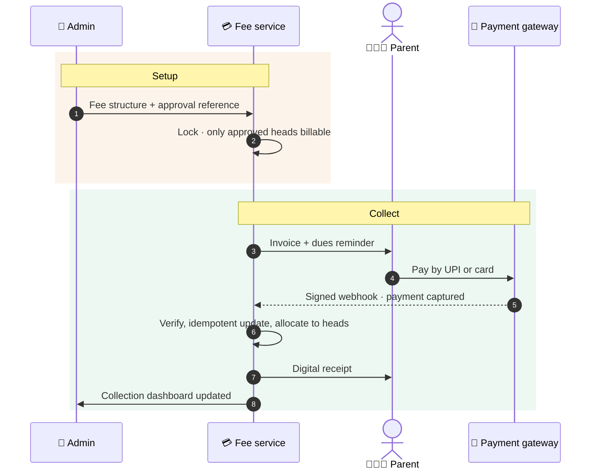
- **Approved-heads lock:** invoices may only contain heads from the active approved structure, matching Tamil Nadu's private-school fee regulation.
- **No hidden parent charges:** no app or convenience fee is added for parents.
- **Public fee-disclosure page**, generated from the locked structure.
- **Money never touches AcadStart:** the gateway settles directly to the school's bank account. A nightly reconciliation job catches missed webhooks.
- **Target:** receipt **≤ 10 s** after payment.

### 7.5 Transport, Safe Handover and the Custody Chain ⭐
**The Custody Chain** treats the child's day as a series of verified handovers between custodians. Normal handovers are logged quietly; parents and the school are alerted only on exceptions.

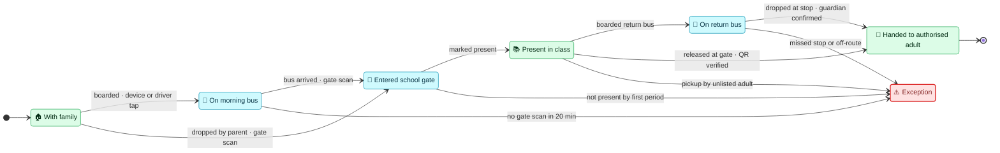

**What the parent sees** (one timeline, in Tamil or English):

| Time | Event | Verified by |
|---|---|---|
| 07:42 | Boarded Bus 3 at Gandhi Nagar stop | Bus attendant tap + GPS |
| 08:15 | Entered school, Gate 1 | Gate scan |
| 08:30 | Present in Class 5B | Teacher attendance |
| 15:40 | Handed to *Amma* at Gate 2 | Rotating QR + photo check |

**Safe Handover at the gate:**
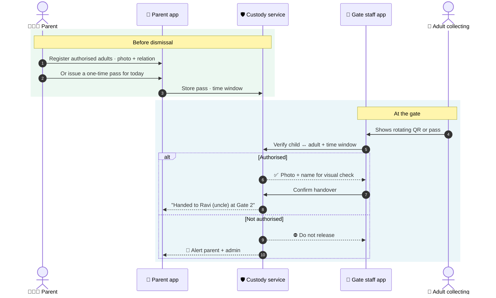

**Bus tracking pipeline, built for the 7:30 am rush:**
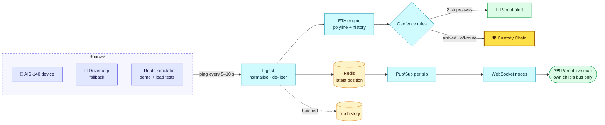
- **Hardware first, phone as backup:** many school buses already carry mandated AIS-140 trackers, so AcadStart integrates those instead of selling hardware.
- **Peak-load math:** 1,500 buses × 1 ping / 5 s ≈ 300 msg/s, which is small. The real peak is ~50,000 parents watching at 7:30 am, handled by horizontally scaled WebSocket nodes, with fallback to a cached 15-second poll.
- **Privacy by scope:** a parent sees only their own child's bus, only during that trip.
- **Targets:** map **≤ 10 s** behind reality; ETA error **≤ 3 min**; custody-exception alert **≤ 60 s** after the rule triggers; handover confirmation to the parent **≤ 30 s** after a gate scan.

### 7.6 Voice-first Tamil assistant + two-way translated messaging ⭐
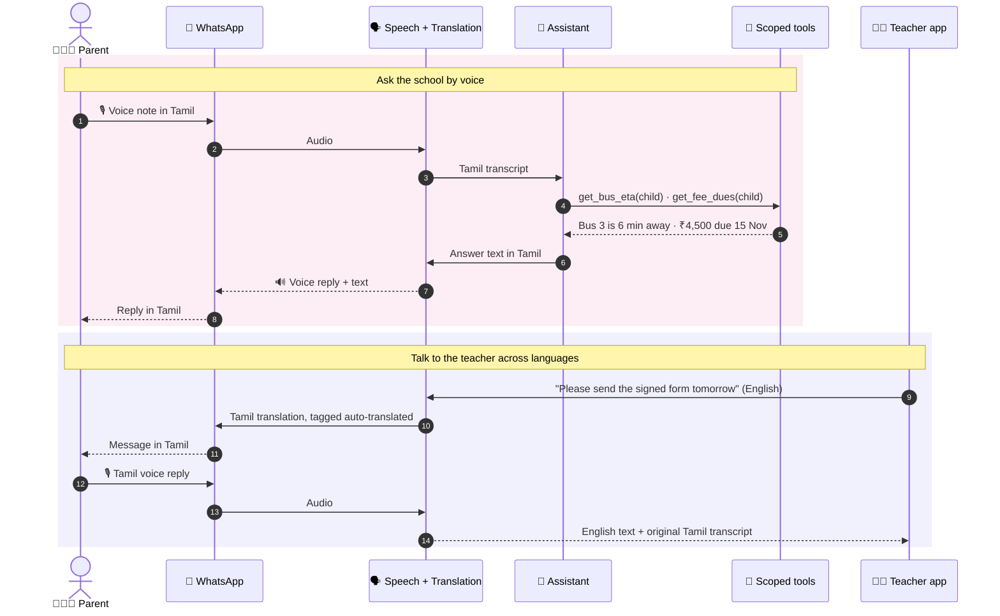
- **Tool-calling, not open data access:** the assistant can only call narrow tools (`get_homework`, `get_attendance`, `get_fee_dues`, `get_bus_eta`, `get_custody_timeline`, `get_circulars`, `get_menu`), and only for children linked to the verified phone number.
- **Languages:** Tamil, English and code-mixed "Tanglish", by text or voice. Translations are always tagged as automatic, with the original one tap away.
- **School glossary:** class names, subjects and staff names are kept untranslated, to avoid mistranslating proper nouns.
- **Escalation:** complaints, sensitive or out-of-scope questions become tickets for the school office.
- **Cost control:** a small fast model handles routine questions, with a larger model only for complex ones. Common answers (today's menu) are cached, and each school has a message quota.
- **Targets:** text reply **≤ 5 s**; voice reply **≤ 8 s**; ≥ 70% of routine office queries answered without staff.

### 7.7 Identity and verifiable records
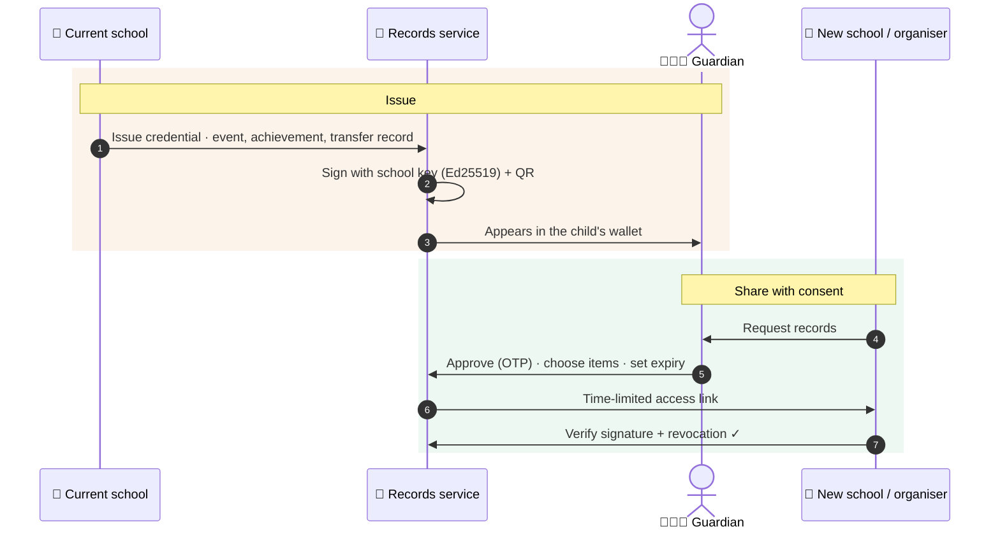
- **Parent-held, consent-based**, verifiable by anyone via QR (W3C Verifiable Credentials data model).
- **Complements the official TC** issued through the state system (EMIS in Tamil Nadu); it doesn't replace it.
- **Never shared by default:** conduct remarks, health notes, custody logs. No cross-school profiles of children.

### 7.8 Management dashboard
Live tiles for attendance %, custody exceptions, buses on the road, fee collection vs. due, unsigned slips and open parent tickets. Drill down by class and section. Exports in EMIS/UDISE+-friendly formats, so staff don't type the same data twice.

## 8. Privacy, security & compliance by design
| Area | Approach |
|---|---|
| **Children's data (DPDP Act 2023 + Rules 2025)** | School = data fiduciary, AcadStart = processor. Verifiable guardian consent. Purpose limitation to education and child safety. **No ads, no profiling or behaviour scoring of children, no facial recognition.** |
| **Custody Chain data** | Handover and location logs visible only to the child's guardians and authorised staff. Detailed logs kept for a short, configurable window (default 90 days), then summarised. Pickup photos encrypted and shown only at the gate during verification. |
| **Voice and images** | Voice notes deleted after transcription (default 24 h). Scanned register images deleted after confirmation + a short retention window. AI providers are contractually barred from training on school data. |
| **Data residency** | All data hosted in India. |
| **Tenant isolation** | PostgreSQL row-level security; per-tenant encryption keys for sensitive fields. |
| **Access control** | Role-based; teachers see only their sections, parents only their children, gate staff only dismissal verification. All admin actions are audit-logged. |
| **Security** | TLS, encryption at rest, OTP rate limits, signed webhooks, secrets vault, dependency scanning, **third-party security audit (VAPT) before any real data**. |
| **Fee regulation** | Approved-heads lock, approval references, public disclosure, no parent-side app fees. |
| **Payments** | Licensed gateway; direct settlement to the school; AcadStart never holds funds. |
| **Prototype rule** | **Synthetic data only** until the security audit and legal review of consent flows are done. |

## 9. Game plan
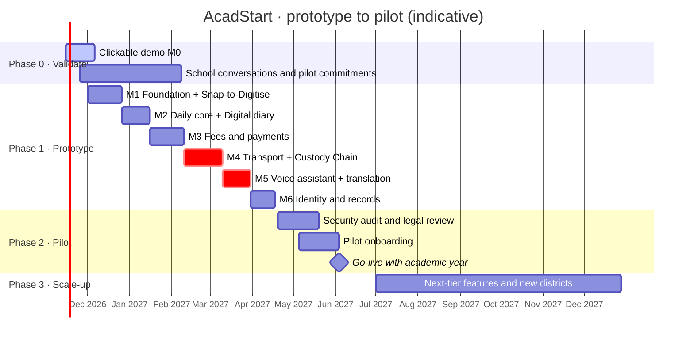

### Phase 0: Validate (now → Feb 2027)
- **Build:** M0 clickable demo, leading with the Custody Chain timeline, a Tamil voice-note exchange and a Snap-to-Digitise run.
- **Do:** demo to ~10–15 private schools (Coimbatore and Chennai first); capture their top pains, current tools and decision makers.
- **Exit criteria:** **≥ 5 schools committed to a pilot** for the June 2027 academic year. Otherwise revisit scope before writing production code.

### Phase 1: Prototype (Dec 2026 → Apr 2027)
Build M1 → M6 on synthetic data, one module at a time, each with a demo script, seed data for a fictional Tamil Nadu school, automated tests for critical paths (fee lock, webhooks, consent, tenant isolation, custody exception rules) and load tests for the morning peak.
**Exit criteria:** a full simulated school day runs end to end:
- A paper register is snapped and imported.
- Attendance is marked offline and synced.
- A permission slip is signed.
- A fee is paid by UPI (test mode).
- Two buses are tracked, and the Custody Chain completes for a class, with one simulated exception caught.
- A parent asks by Tamil voice note and a teacher replies in English.
- A certificate is issued and verified by QR.

### Phase 2: Pilot (Apr → Jul 2027)
- Security audit; legal review of consent flows and data-processing agreements.
- On-ground onboarding with Snap-to-Digitise; teacher training (≤ 1 hour); gate staff training (≤ 30 min); parent rollout via WhatsApp invite links.
- **Exit criteria (first 8 weeks):** ≥ 70% of parents active weekly; ≥ 60% of fees paid online; custody timeline complete for ≥ 95% of bus-riding students; ≥ 80% slip sign-off within deadline; zero data-isolation incidents.

### Phase 3: Scale-up (from Jul 2027)
Grow by district cluster, ship the most-requested items below, harden infrastructure, and add Puducherry and further states through configurable regional compliance packs.

## 10. Scale-up features (open-ended)
> This list is **intentionally open-ended**: it grows with what schools, parents and teachers actually ask for. Pilot feedback sets the priorities, not this order. Have an idea? Open an issue with the `feature-idea` label.

**Next tier (first candidates after the pilot)**
- [ ] **Fee AutoPay + sibling wallet**: UPI AutoPay mandates for monthly or term fees, one account for all children (even across AcadStart schools), reminders timed to salary dates
- [ ] **State Sync Pack**: enter once, generate ready-to-upload EMIS/UDISE+ files with a "what's due" checklist
- [ ] **Parent learning nudges**: 2–3 short Tamil/English messages a week on what the child is learning and a 5-minute home activity
- [ ] **Attendance nudges**: research-informed, non-shaming outreach to parents of frequently absent children, with teacher escalation
- [ ] **NEP Holistic Progress Card**: learning-outcome (mastery) gradebook with self, peer and parent inputs
- [ ] **Teacher Copilot**: lesson-plan drafts from the syllabus calendar, worksheets from the exact chapter, report-card remark drafts (teacher approves)
- [ ] **Verified Event Passport**: inter-school events and olympiads registered with verified records, results issued back as credentials

**Academics**
- [ ] Exams, marks entry and report cards (State Board, CBSE and ICSE formats)
- [ ] Automatic timetable generation (constraint solver) and substitution management
- [ ] Curriculum coverage tracking
- [ ] LMS: study material, online classes, quizzes
- [ ] Co-curricular and sports records; house points

**Parents & students**
- [ ] School-supplies marketplace: booklists, uniforms and stationery from local vendors, **parent's free choice**, transparent pricing, fully separate from school fees
- [ ] Parent–teacher meeting scheduling
- [ ] Leave requests and early pick-up requests (into Safe Handover)
- [ ] Cafeteria pre-orders, allergy flags and canteen wallet
- [ ] Student portfolio and achievements timeline
- [ ] More languages (Hindi, Malayalam, Telugu, Kannada, …)

**Safety & transport**
- [ ] RFID/NFC cards as extra Custody Chain scan methods
- [ ] SOS/panic-button integration with AIS-140 devices
- [ ] Anonymous safe-reporting channel for students and parents to the counsellor or POCSO committee
- [ ] Visitor management and gate passes
- [ ] Driver behaviour analytics (speeding, harsh braking) from device data
- [ ] Route optimisation for new admissions

**Management & operations**
- [ ] Admissions CRM: enquiries, applications, follow-ups
- [ ] HR, staff attendance and payroll (via payroll-provider integrations)
- [ ] Library, inventory, assets and hostel
- [ ] Multi-campus and school-chain dashboards
- [ ] Fee instalments/EMI via licensed financing partners
- [ ] Accounting exports (Tally etc.) and GST-ready reports

**Identity, records & openness**
- [ ] Teacher-held verified profile (qualifications and service history, consent-based)
- [ ] DigiLocker integration (subject to approval as a partner)
- [ ] Deeper EMIS / UDISE+ / APAAR interoperability, subject to official access
- [ ] Open API + webhooks on an open data standard, with one-click full export (no lock-in)
- [ ] Alumni records and verified transcripts

**Platform**
- [ ] White-label apps for school chains
- [ ] Higher-education edition (credits, semesters, placements)
- [ ] Puducherry, then other states, via regional compliance packs
- [ ] _…your idea here_

## 11. Tech stack
| Layer | Choice | Why |
|---|---|---|
| Mobile app | **Flutter** (one app, role-based views incl. gate mode) | One codebase for Android and iOS; fast on 2 GB Android phones; offline SQLite; camera and QR built in |
| Web admin | **Next.js + TypeScript + Tailwind** | Fast to build data-heavy admin screens |
| Backend | **Python (FastAPI)** as a modular monolith | Strong AI ecosystem, typed, async |
| Database | **PostgreSQL** + row-level security | Integrity for fees, custody and records; tenant isolation in the DB |
| Realtime | **Redis** pub/sub + **WebSockets**; **MQTT/TCP** device ingest | Live maps and custody events without touching the main DB |
| Maps | **OpenStreetMap + OSRM** (self-hosted), optional commercial maps | Predictable costs |
| Messaging | **WhatsApp Business API**, FCM/APNs push, DLT-registered SMS fallback | Parents already live on WhatsApp |
| Payments | **Licensed Indian payment gateway** (UPI, cards, netbanking) | Direct settlement to schools |
| AI: assistant | **LLM with tool-calling** (small model for routine, larger for complex) | Strict tool scoping; Tamil/English |
| AI: speech | **Tamil/English STT + TTS** (cloud APIs or Indic open models such as AI4Bharat) | Voice-first parents |
| AI: translation | **LLM or Indic MT models** (e.g., IndicTrans2) with a school glossary | Accurate names and school terms |
| AI: vision | **Vision-language model + OCR** with roster matching | Snap-to-Digitise |
| Credentials | **Ed25519**, W3C Verifiable Credentials, QR | Verifiable without the platform |
| Infra | Docker, India-region cloud, GitHub Actions CI | Simple start; split modules as needed |
| Observability | Structured logs, metrics, tracing, uptime alerts | The morning rush must never surprise us |

## 12. Planned repository layout
```
acadstart/
├── apps/
│   ├── mobile/            # Flutter app: parent · teacher · student · driver · gate
│   ├── admin-web/         # Next.js admin panel
│   └── demo/              # M0 clickable demo
├── services/
│   └── api/               # FastAPI modular monolith
│       ├── identity/      ├── academics/     ├── communication/
│       ├── fees/          ├── transport/     ├── custody/
│       ├── records/       └── ai/            # assistant · speech · translation · digitise
├── tools/
│   ├── route-simulator/   # replays bus routes for demos and load tests
│   └── seed-data/         # synthetic Tamil Nadu school (incl. sample paper registers)
├── infra/                 # docker-compose, deployment, CI
└── docs/                  # ADRs, API docs, runbooks
```

## 13. Non-functional targets
| Metric | Prototype target |
|---|---|
| API latency (p95) | ≤ 300 ms |
| Bus position freshness on the parent map | ≤ 10 s |
| Handover confirmation to the parent after a gate scan | ≤ 30 s |
| Custody exception alert after the rule triggers | ≤ 60 s |
| Concurrent parent viewers at peak | 50,000 (load-tested) |
| Payment receipt after capture | ≤ 10 s |
| Assistant reply (text / voice) | ≤ 5 s / ≤ 8 s |
| Snap-to-Digitise: 40-row page reviewed and committed | < 2 min, ≥ 95% cells correct pre-review |
| Mobile app install size | ≤ 30 MB |
| Devices | Android 8+ with 2 GB RAM on 4G; attendance works offline |
| School onboarding | 1,000-student school live in 1 working day |
| Availability (pilot) | 99.5% monthly, prioritised for 7–9 am and 2–5 pm |

## 14. Glossary
| Term | Meaning |
|---|---|
| **AIS-140** | Indian standard for vehicle tracking devices and emergency buttons in public and school transport |
| **APAAR ID** | "One Nation One Student" academic ID, generated with parental consent |
| **Custody Chain** | AcadStart's verified, door-to-door log of who is responsible for a child at each point of the school day |
| **DPDP Act** | Digital Personal Data Protection Act 2023, India's data-protection law, with special rules for children |
| **EMIS** | Tamil Nadu's Educational Management Information System, the state's system of record for students and schools |
| **UDISE+** | National school database; issues school codes and student numbers (PEN) |
| **TC** | Transfer Certificate, issued when a student leaves a school |
| **Fee committee** | State body that fixes or approves private-school fees |
| **Verifiable credential** | A digitally signed record whose authenticity can be checked independently |

## 15. Contributing & license
The project is in its design phase and not yet open for code contributions. Feedback and ideas are welcome via **Issues** (`feature-idea`, `question`).

**License:** not yet chosen. Until a license is added, all rights are reserved by the author.

---
<div align="center"><sub>Maintained by <a href="https://github.com/Vijay190899">@Vijay190899</a></sub></div>
