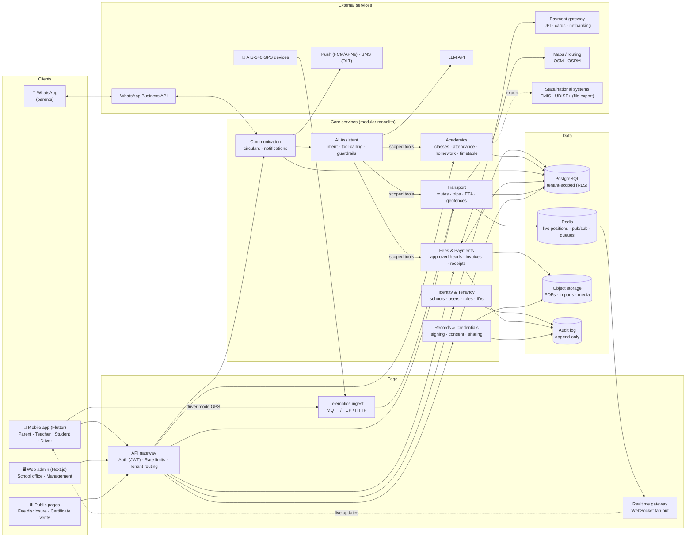
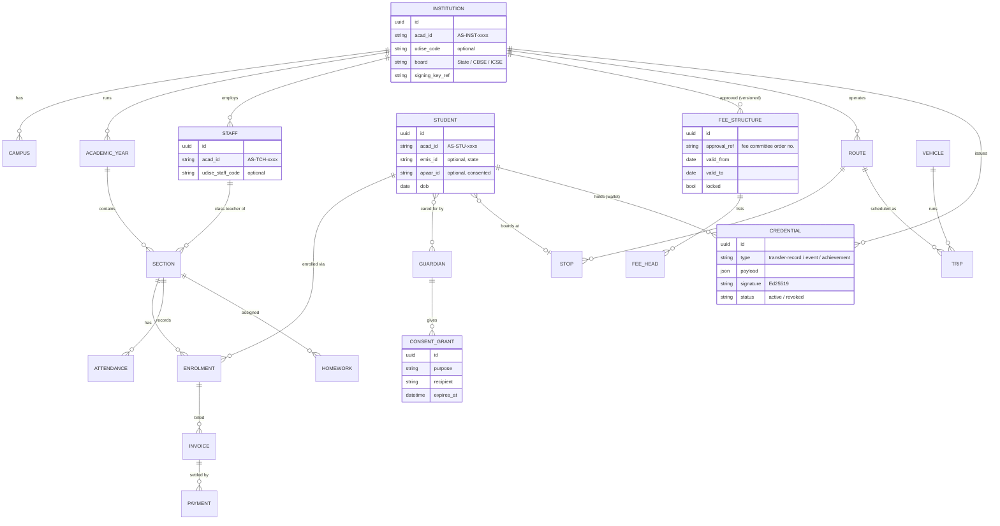
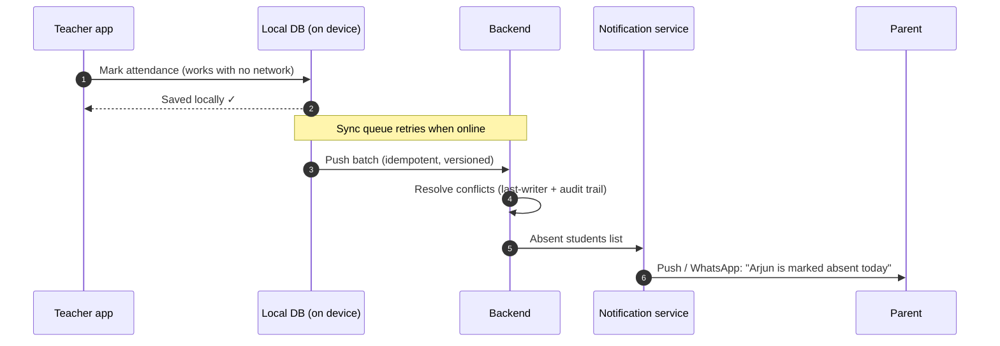
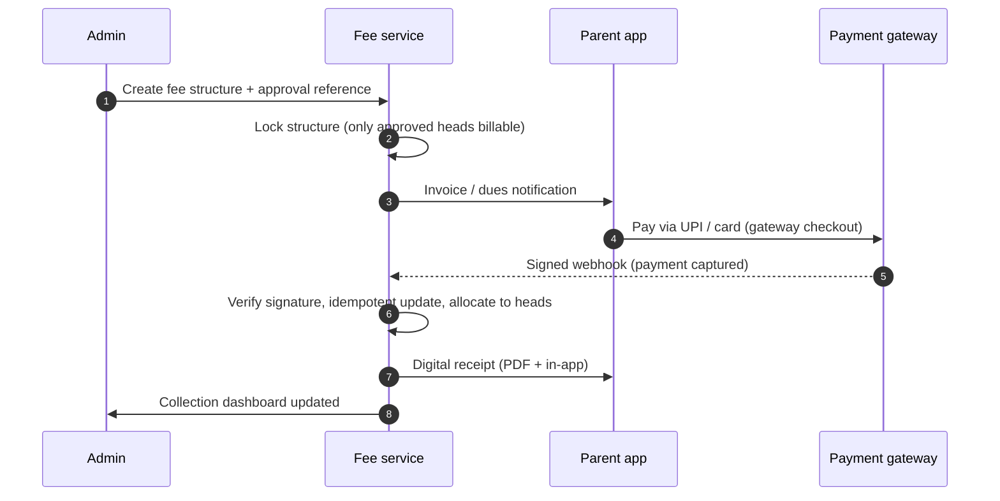
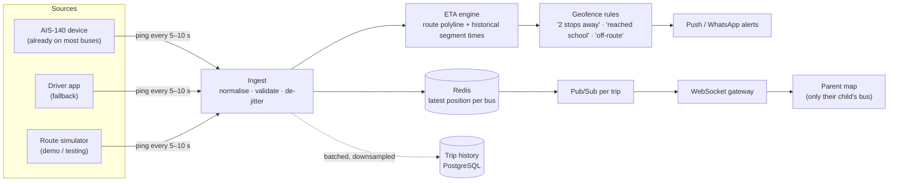
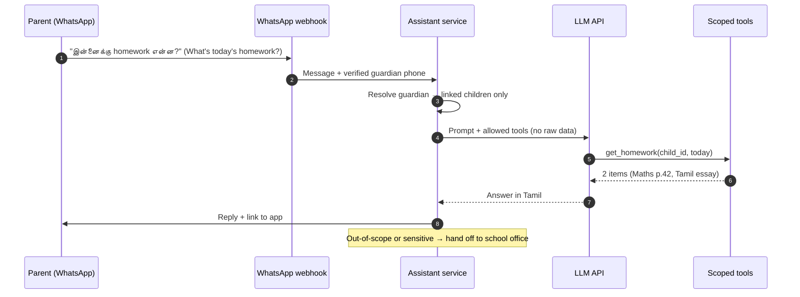
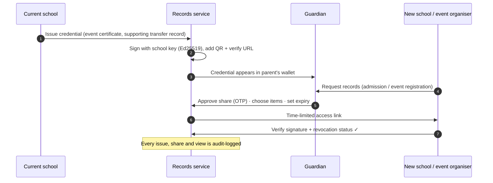
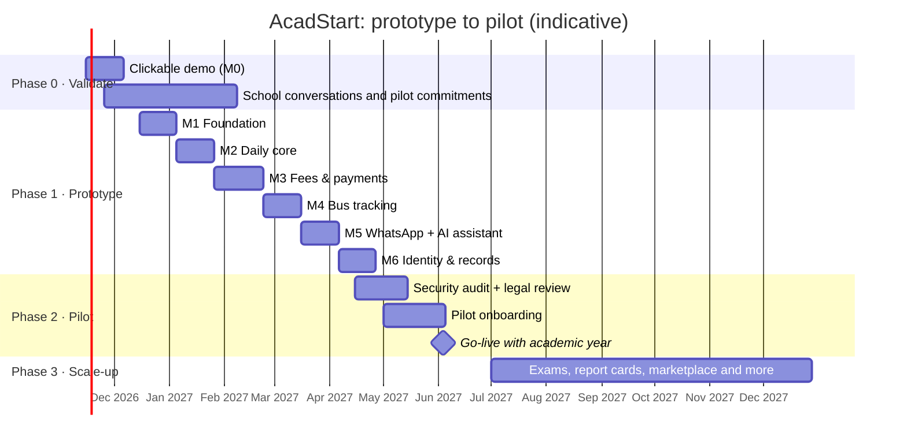

# AcadStart

**One platform for the whole school day: for management, teachers, parents and students.**
Fees, attendance, homework, live school-bus tracking, verifiable student records and a Tamil + English AI assistant, built mobile-first for Indian schools. Launching first in Tamil Nadu.

> **Status:** 🧪 Prototype / design phase. This README is the product and technical blueprint for the prototype. Code will land module by module, following the [game plan](#7-game-plan).
> **Working name:** "AcadStart" is a placeholder.

---

## Table of contents
1. [Why this exists](#1-why-this-exists)
2. [Who it's for](#2-who-its-for)
3. [Prototype feature set](#3-prototype-feature-set)
4. [System architecture](#4-system-architecture)
5. [How each feature works and performs](#5-how-each-feature-works-and-performs)
6. [Privacy, security & compliance by design](#6-privacy-security--compliance-by-design)
7. [Game plan](#7-game-plan)
8. [Scale-up features (open-ended)](#8-scale-up-features-open-ended)
9. [Tech stack](#9-tech-stack)
10. [Planned repository layout](#10-planned-repository-layout)
11. [Non-functional targets](#11-non-functional-targets)
12. [Glossary](#12-glossary)
13. [Contributing & license](#13-contributing--license)

---

## 1. Why this exists
Most private schools in India still run on paper registers, Excel sheets and dozens of WhatsApp groups. Parents chase fee receipts and wonder where the bus is. Teachers re-enter the same data into multiple government and school systems. Management has no single view of the school.

AcadStart aims to be **the one app a school actually needs**:
- **Wedge first:** fees, attendance, homework and parent communication, the things a school uses every single day.
- **Then the differentiators:** live bus tracking from the GPS devices buses already carry, a Tamil/English AI assistant on WhatsApp, and **parent-controlled, verifiable student records** that move with the child.
- **Compliance built in:** approved-fee-only billing, public fee disclosure, state-system (EMIS / UDISE+) friendly exports, and child-data protection under India's DPDP Act.

## 2. Who it's for
| Role | What they get |
|---|---|
| 🏫 **Management / Admin** | Dashboard of the whole institution: enrolment, attendance, fee collection, transport, events. Configure classes, fee structures, routes and staff. |
| 👩‍🏫 **Teacher** | Class and timetable overview, one-tap attendance (works offline), homework and assignments, remarks to parents, exam prep. |
| 👨‍👩‍👧 **Parent / Guardian** | Child's day at a glance: attendance, homework, circulars, fee dues and online payment, live bus location and ETA, cafeteria menu, records wallet. Tamil or English. |
| 🎒 **Student** | Timetable, assignments and due dates, announcements, certificates. |
| 🚌 **Driver / Transport staff** | Trip start/stop, route view, pickup/drop confirmation (fallback tracking when the bus has no GPS device). |

All roles live in **one mobile app with role-based views**, plus a **web admin panel** for school offices.

## 3. Prototype feature set
The prototype is deliberately narrow: enough to run a real school day end to end, nothing more.

| # | Module | Prototype scope | Roles |
|---|---|---|---|
| M1 | **Foundation** | Multi-school tenancy, phone-OTP login, roles, school setup wizard, Excel/CSV import of students, guardians and staff, unique IDs | All |
| M2 | **Daily core** | Attendance (daily + period-wise, offline-capable), absence alerts, homework/assignments, circulars/announcements, events calendar, timetable viewer, cafeteria menu | Teacher, Parent, Student, Admin |
| M3 | **Fees** | Fee structures locked to **approved fee heads**, invoices, instalments and concessions, online payment (UPI/cards via a payment gateway, test mode), receipts, dues reminders, **public fee-disclosure page** | Admin, Parent |
| M4 | **Bus tracking** | Routes and stops, live bus map for parents, ETA, "bus is 2 stops away" and "child dropped" alerts. Ingest from existing **AIS-140 GPS devices**, or from the **driver app** as fallback, plus a **route simulator** for demos | Parent, Admin, Driver |
| M5 | **Messaging + AI assistant** | WhatsApp + push notifications; AI assistant answering parent questions in **Tamil or English** ("Is there homework today?", "What fees are due?", "Where's the bus?") from the school's own data | Parent, Admin |
| M6 | **Identity & records** | Unique IDs for institutions, teachers and students (with optional links to national/state IDs), **digitally signed, QR-verifiable certificates** (event participation, achievements, supporting transfer records), parent-approved sharing to another school or event organiser | Parent, Admin, Teacher |
| M0 | **Clickable demo** | No-backend interactive walkthrough of all of the above for school demos | — |

**Out of scope for the prototype** (see [Scale-up](#8-scale-up-features-open-ended)): exams and report cards, the supplies marketplace, admissions CRM, HR/payroll, library/inventory/hostel, and government integrations beyond file export.

## 4. System architecture

### 4.1 High-level view


**Design choices**
- **Modular monolith first:** one deployable backend with strict module boundaries. That's cheap to run and easy to change, and each module can be split into its own service later (transport and messaging are the first candidates).
- **Tenant isolation:** every row carries `institution_id`. PostgreSQL **row-level security** enforces it, so a bug in application code can't leak one school's data to another.
- **Realtime is separate from request/response:** live bus positions flow through Redis pub/sub to a WebSocket gateway and never touch the main database on the hot path.
- **Integrations sit behind adapters:** payment gateway, WhatsApp provider, LLM, maps and GPS vendors are swappable.

### 4.2 Core data model (prototype)


## 5. How each feature works and performs

### 5.1 Foundation: onboarding a school in one day
- **Setup wizard:** school profile → academic year → classes/sections → staff → students/guardians.
- **Excel/CSV import** with column auto-mapping, validation and a preview of errors (duplicate admission numbers, invalid phone numbers) before commit. Paper registers can later be digitised via OCR (scale-up).
- **Login:** phone number + OTP (parents rarely use email). One guardian phone can be linked to several children across classes, or even across schools.
- **IDs:** every institution, staff member and student gets a permanent internal ID (`AS-INST-…`, `AS-TCH-…`, `AS-STU-…`). National and state identifiers (UDISE+ code, EMIS ID, APAAR ID) are stored as **optional, linked fields** and never used as primary keys. Aadhaar is never required.
- **Target:** a 1,000-student school imported and live within **one working day**.

### 5.2 Attendance: offline-first

- Marking a class of 40 students takes **under 30 seconds** (everyone is present by default; tap only the absentees).
- Absence alerts reach parents **within 5 minutes** of sync.
- Period-wise attendance, late arrivals and leave requests all build on the same model.

### 5.3 Fees and payments: approved heads only

- **Approved-heads lock:** an invoice can only contain fee heads from the active, approved fee structure, which carries the fee-committee approval reference. Extra charges can't be added ad hoc. This mirrors Tamil Nadu's private school fee regulation and protects the school in audits.
- **No hidden parent charges:** the platform doesn't add app or convenience fees to parents' bills. Payment costs are configured as school-borne.
- **Public fee-disclosure page:** a per-school public page showing the approved structure, generated automatically from the locked data.
- **Money never touches AcadStart:** funds settle from the gateway directly into the school's bank account. AcadStart holds no money, so it needs no payment-aggregator licence.
- **Reliability:** webhook handling is idempotent and signature-verified, and a nightly reconciliation job catches any missed events. **Target:** receipt in the parent's hands within **10 seconds** of payment.

### 5.4 Live bus tracking: built for the 7:30 am rush

- **Hardware first, phone as backup.** Many school buses are already required to carry AIS-140 tracking devices, so AcadStart integrates those feeds instead of selling hardware. The driver app covers buses without devices, but phone GPS is less reliable (battery savers, mobile data being switched off), so it's the fallback.
- **Privacy by scope.** A parent can only subscribe to the live trip their own child is on, only while that trip is running.
- **Peak-load math:** 50 schools × 30 buses = 1,500 buses pinging every 5 s is ~300 messages/s, which a single small instance can handle. The real peak is *parents*: ~50,000 concurrent viewers at 7:30 am. Positions are fanned out via Redis pub/sub to horizontally scalable WebSocket nodes, and if WebSockets fail the client falls back to polling a cached endpoint every 15 s.
- **Targets:** position on the parent's screen **≤ 10 s** behind reality; ETA error **≤ 3 min** on familiar routes; "bus approaching" alert **≥ 5 min** before arrival.

### 5.5 Messaging and the Tamil/English AI assistant

- **Tool-calling, not open data access.** The model can only call narrow, read-mostly tools (`get_homework`, `get_attendance`, `get_fee_dues`, `get_bus_eta`, `get_circulars`, `get_menu`), and only for children linked to the verified phone number.
- **Language:** replies in the parent's language (Tamil, English, or code-mixed "Tanglish").
- **Cost control:** a small, fast model handles routine questions, with a larger model only for complex ones. Answers are cached for common questions (e.g., today's menu), and each school has a per-school message quota.
- **Guardrails:** no medical, legal or disciplinary judgements; complaints are logged as tickets for staff; full audit log of questions and tool calls; no use of children's data for model training.
- **Targets:** reply in **≤ 5 s**. Most routine office queries (homework, dues, bus) resolved without staff involvement.

### 5.6 Identity and verifiable records: records that move with the child, with parent consent

- **Parent-held, consent-based:** records live in the child's wallet, controlled by the guardian. Nothing is shared between institutions without explicit, time-limited, purpose-specific consent.
- **Verifiable anywhere:** each credential is digitally signed by the issuing school and carries a QR code. Anyone can check authenticity on a public verify page, even if they don't use AcadStart. The format follows the W3C Verifiable Credentials data model.
- **Complements official systems:** official transfer certificates are issued through the state's system (EMIS in Tamil Nadu). AcadStart's transfer packet *accompanies* the official TC with marks, attendance summary and certificates; it doesn't replace it.
- **What's never shared by default:** behaviour/conduct remarks and health notes. AcadStart does not build cross-school profiles of children.
- **Teachers:** a teacher-held verified profile (qualifications, service history confirmed by past schools with consent) is planned for scale-up.

### 5.7 Management dashboard
Live tiles for attendance %, fee collection vs. due, buses on the road, open parent tickets and upcoming events. Drill down by class and section. Exports in formats that ease state reporting (EMIS / UDISE+), so staff don't type the same data twice.

## 6. Privacy, security & compliance by design
| Area | Approach |
|---|---|
| **Children's data (DPDP Act 2023 + Rules 2025)** | School = data fiduciary, AcadStart = processor. Verifiable guardian consent flows. Purpose limitation. No tracking or profiling of children beyond education and safety. **No ads, ever.** Data-retention and deletion policies per school. |
| **Data residency** | All data hosted in India (Mumbai region). |
| **Tenant isolation** | PostgreSQL row-level security on every table; per-tenant encryption keys for sensitive fields. |
| **Access control** | Role-based permissions; teachers only see their sections; parents only their own children; all admin actions audit-logged. |
| **Security** | TLS everywhere, encryption at rest, OTP rate limiting, signed webhooks, secrets in a vault, dependency scanning, **third-party security audit (VAPT) before any real student data**. |
| **Fee regulation** | Approved-fee-heads lock, approval references, public fee disclosure, no parent-side app fees. |
| **Transport** | Integrates AIS-140 devices; live location visible only to guardians of children on that trip, only during the trip. |
| **Payments** | Licensed payment gateway; settlement direct to the school; AcadStart never holds funds. |
| **Prototype rule** | **Synthetic data only** until security review and legal review of consent flows are done. |

## 7. Game plan


### Phase 0: Validate (now → Feb 2027)
- **Build:** M0 clickable demo covering every role.
- **Do:** walk ~10–15 private schools (Coimbatore and Chennai first) through the demo; record their top pains, current tools and who decides.
- **Exit criteria:** **≥ 5 schools committed to a pilot** for the June 2027 academic year. If not met, revisit scope or wedge before writing production code.

### Phase 1: Prototype (Dec 2026 → Apr 2027)
Build M1 to M6 as working software on synthetic data, one module at a time, each with:
- A demo script and seed data for a fictional Tamil Nadu school.
- Automated tests for the critical paths (fee lock, payment webhooks, consent and sharing, tenant isolation).
- Load tests for the bus-tracking morning peak.
- **Exit criteria:** a full simulated school day runs end to end. Morning attendance, homework, a fee paid via UPI test mode, two buses tracked live, a parent asking the assistant in Tamil, and a certificate issued and verified by QR.

### Phase 2: Pilot (Apr → Jul 2027)
- Third-party security audit; legal review of consent flows and data-processing agreements.
- On-ground onboarding: data import, teacher training (≤ 1 hour), parent app rollout via WhatsApp invite links.
- Weekly feedback loop with each pilot school.
- **Exit criteria (first 8 weeks live):** ≥ 70% of parents active weekly; ≥ 60% of fees collected online; absence alerts on ≥ 90% of school days; school-office queries noticeably reduced; no data-isolation incidents.

### Phase 3: Scale-up (from Jul 2027)
Expand by district cluster, add the modules pilot schools ask for most (see below), harden infrastructure, and extend to Puducherry and further states with configurable regional rules.

## 8. Scale-up features (open-ended)
> This list is **intentionally open-ended**: it grows with what schools, parents and teachers actually ask for. Priorities are set by pilot feedback, not by this order. Have an idea? Open an issue with the `feature-idea` label.

**Academics**
- [ ] Exams, marks entry and report cards (State Board, CBSE and ICSE formats; holistic progress cards)
- [ ] AI-drafted report-card remarks (teacher reviews and approves)
- [ ] Automatic timetable generation (constraint solver) and substitution management
- [ ] Lesson plans and curriculum coverage tracking
- [ ] Question-paper and worksheet generator aligned to the syllabus
- [ ] LMS: study material, online classes, quizzes
- [ ] Co-curricular and sports records; house system and points

**Parents & students**
- [ ] School-supplies marketplace: booklists, uniforms and stationery from local vendors, **parent's free choice**, transparent pricing, kept fully separate from school fees
- [ ] Parent–teacher meeting scheduling
- [ ] Leave requests and early pick-up authorisation (with gate verification)
- [ ] Cafeteria pre-orders, allergy flags and canteen wallet
- [ ] Student portfolio and achievements timeline in the records wallet
- [ ] Multi-language support beyond Tamil and English (Hindi, Malayalam, Telugu, Kannada, …)

**Transport & safety**
- [ ] RFID/NFC boarding check-in, with alerts to parents when the child boards or alights
- [ ] Driver behaviour analytics (speeding, harsh braking) from device data
- [ ] Route optimisation for new admissions
- [ ] SOS/panic-button integration with AIS-140 devices
- [ ] Visitor management and gate passes

**Management & operations**
- [ ] Admissions CRM: enquiries, applications, follow-ups, online admission forms
- [ ] HR, staff attendance and payroll (via integrations with payroll providers)
- [ ] Library, inventory, assets and hostel management
- [ ] Multi-campus and school-chain dashboards
- [ ] Fee-default prediction and gentle reminder sequencing (parent-level, no child profiling)
- [ ] Fee instalment/EMI options via licensed financing partners
- [ ] Accounting exports (Tally etc.) and GST-ready reports

**Identity & records**
- [ ] Teacher-held verified profile (qualifications and service history)
- [ ] DigiLocker integration (subject to approval as a partner)
- [ ] Deeper state-system interoperability (EMIS, UDISE+, APAAR), subject to official access
- [ ] Inter-school event and competition registrations using verified credentials
- [ ] Alumni records and verified transcripts for higher education

**Platform**
- [ ] OCR + AI digitisation of paper registers for faster onboarding
- [ ] Offline-first for all teacher workflows
- [ ] Open API and webhooks for third-party integrations
- [ ] White-label apps for large school chains
- [ ] Higher-education edition (colleges: credits, semesters, placements)
- [ ] Puducherry, then other states, via configurable regional compliance packs
- [ ] _…your idea here_

## 9. Tech stack
| Layer | Choice | Why |
|---|---|---|
| Mobile app | **Flutter** (one app, role-based views) | Single codebase for Android and iOS; performs well on low-end 2 GB Android phones; offline storage via SQLite |
| Web admin | **Next.js + TypeScript + Tailwind** | Fast to build, good for data-heavy admin screens |
| Backend | **Python (FastAPI)**, as a modular monolith | Strong AI/ML ecosystem, typed, async; one deployable to start |
| Database | **PostgreSQL** with row-level security | Relational integrity for fees and records; tenant isolation in the database |
| Cache / realtime | **Redis** (pub/sub, queues, live positions) | Keeps the bus-tracking hot path out of the main DB |
| Realtime transport | **WebSockets**; **MQTT/TCP** ingest for GPS devices | Standard for live maps; matches device protocols |
| Maps & routing | **OpenStreetMap + OSRM** (self-hosted), optional commercial maps | Keeps map costs predictable at scale |
| Messaging | **WhatsApp Business API**, FCM/APNs push, DLT-registered SMS fallback | WhatsApp is where Indian parents already are |
| Payments | **Licensed Indian payment gateway** (UPI, cards, netbanking) | Direct settlement to schools |
| AI | **LLM API with tool-calling** (small model for routine queries, larger for complex) | Tamil/English understanding; strict tool scoping |
| Credentials | **Ed25519 signatures**, W3C Verifiable Credentials data model, QR verification | Standard, verifiable without the platform |
| Infra | Docker; India-region cloud; CI via GitHub Actions | Simple to start, scales by splitting modules |
| Observability | Structured logs, metrics, tracing, uptime alerts | The morning peak must never surprise us |

## 10. Planned repository layout
```
acadstart/
├── apps/
│   ├── mobile/          # Flutter app (parent · teacher · student · driver)
│   ├── admin-web/       # Next.js admin panel
│   └── demo/            # M0 clickable demo
├── services/
│   └── api/             # FastAPI modular monolith
│       ├── identity/    ├── academics/   ├── communication/
│       ├── fees/        ├── transport/   ├── records/
│       └── assistant/
├── tools/
│   ├── route-simulator/ # replays bus routes for demos and load tests
│   └── seed-data/       # synthetic Tamil Nadu school data
├── infra/               # docker-compose, deployment, CI
└── docs/                # architecture decisions (ADRs), API docs, runbooks
```

## 11. Non-functional targets
| Metric | Prototype target |
|---|---|
| API latency (p95) | ≤ 300 ms |
| Bus position freshness on parent screen | ≤ 10 s |
| Concurrent parent viewers at peak | 50,000 (load-tested) |
| Payment receipt after capture | ≤ 10 s |
| AI assistant reply | ≤ 5 s |
| Mobile app install size | ≤ 30 MB |
| Works on | Android 8+ phones with 2 GB RAM on 4G; attendance works offline |
| School onboarding | 1,000-student school live in 1 working day |
| Availability (pilot) | 99.5% monthly, higher during 7–9 am and 2–5 pm |

## 12. Glossary
| Term | Meaning |
|---|---|
| **AIS-140** | Indian standard for vehicle location tracking devices and emergency buttons on public and school transport |
| **APAAR ID** | "One Nation One Student" academic ID, generated with parental consent |
| **DPDP Act** | Digital Personal Data Protection Act 2023, India's data-protection law, with special rules for children's data |
| **EMIS** | Tamil Nadu's Educational Management Information System, the state's student/school system of record |
| **UDISE+** | National school database; issues school codes and student numbers (PEN) |
| **TC** | Transfer Certificate, issued when a student leaves a school |
| **Fee committee** | State body that fixes or approves private school fees (Tamil Nadu has one) |
| **Verifiable credential** | A digitally signed record whose authenticity can be checked independently |

## 13. Contributing & license
This project is in its design phase and not yet open for code contributions. Feedback and ideas are welcome via **Issues** (`feature-idea`, `question`).

**License:** not yet chosen. Until a license is added, all rights are reserved by the author.

---
_Maintained by [@Vijay190899](https://github.com/Vijay190899)._
